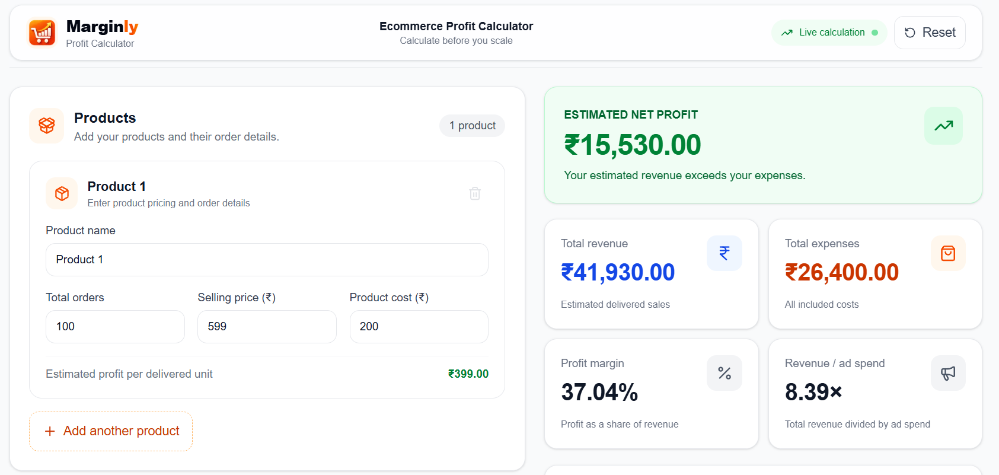

# Marginly - Ecommerce Profit Calculator

**Calculate your profit before you scale.**

Marginly is a free ecommerce profit calculator built to help online sellers estimate their revenue, expenses, net profit, and profit margin.

It helps sellers understand how product costs, delivery rates, shipping charges, Return to Origin (RTO) costs, advertising spend, and other expenses affect their estimated profit.

The goal of Marginly is to make ecommerce profit calculation simple, clear, and accessible to everyone.

## Live Demo

Try Marginly here:

**https://marginly-five.vercel.app/**

## Screenshots

### Main Dashboard



## Features

### Product Management

- Add multiple products to a single calculation.
- Enter product names, order quantities, selling prices, and product costs.
- Update product details and remove products.
- Reset the calculator to its default values.

### Profit Calculation

- Calculate estimated revenue from delivered orders.
- Estimate delivered and RTO order quantities using the delivery rate.
- Calculate product costs, shipping expenses, and RTO charges.
- Include advertising spend, platform fees, and other expenses.
- View total revenue, total expenses, net profit, and profit margin.
- Calculate profit per delivered order.

### Export and Sharing

- Export calculator data to CSV.
- Export calculator data to JSON.
- Copy or share a summary of the calculation.

### User Interface

- Responsive interface for desktop and mobile devices.
- Live calculation updates when input values change.
- Currency and percentage formatting.
- Input validation for product values.
- SEO metadata and application branding.

## Why Marginly?

Selling products online does not guarantee a profit. Sellers also need to consider delivery expenses, returned orders, advertising, and other business costs.

Marginly brings these calculations together in one place. It helps sellers estimate their profitability and make more informed decisions about product pricing and business expenses.

## Tech Stack

| Technology | Purpose |
|---|---|
| Next.js | Application framework and routing |
| React | User interface and components |
| JavaScript | Application logic |
| Tailwind CSS | Styling and responsive design |
| Lucide React | Icons |
| Vitest | Unit testing |
| Testing Library | Component testing utilities |
| GitHub Actions | Automated testing, linting, and build checks |
| Vercel | Application deployment |

## Project Structure

```text
marginly/
├── .github/
│   ├── ISSUE_TEMPLATE/
│   │   ├── bug_report.yml
│   │   └── feature_request.yml
│   └── workflows/
│       └── ci.yml
├── public/
│   ├── logo.png
│   └── marginly-dashboard.png
├── src/
│   ├── app/
│   │   ├── globals.css
│   │   ├── layout.js
│   │   └── page.js
│   ├── features/
│   │   └── profit-calculator/
│   │       ├── components/
│   │       │   ├── CalculatorForm.jsx
│   │       │   ├── CalculatorHeader.jsx
│   │       │   ├── ExpenseBreakdown.jsx
│   │       │   ├── ExpenseInputs.jsx
│   │       │   ├── ExportShareActions.jsx
│   │       │   ├── MetricCard.jsx
│   │       │   ├── ProductList.jsx
│   │       │   ├── ProductRow.jsx
│   │       │   └── ProfitSummary.jsx
│   │       ├── constants/
│   │       │   └── calculatorDefaults.js
│   │       ├── hooks/
│   │       │   └── useProfitCalculator.js
│   │       └── lib/
│   │           ├── calculateProfit.js
│   │           ├── calculateProfit.test.js
│   │           ├── exportCalculator.js
│   │           ├── formatCurrency.js
│   │           ├── shareCalculator.js
│   │           └── validators.js
│   └── lib/
├── tests/
│   └── setup.js
├── .gitignore
├── eslint.config.mjs
├── jsconfig.json
├── next.config.mjs
├── package.json
├── package-lock.json
├── README.md
└── vitest.config.js
```

## Getting Started

Follow these steps to run Marginly locally.

### Prerequisites

Install the following tools before starting:

- Node.js
- npm
- Git

### 1. Clone the Repository

Replace `YOUR_USERNAME` with your GitHub username.

```bash
git clone https://github.com/YOUR_USERNAME/marginly.git
```

### 2. Navigate to the Project

```bash
cd marginly
```

### 3. Install Dependencies

```bash
npm install
```

### 4. Start the Development Server

```bash
npm run dev
```

### 5. Open the Application

Visit the following URL in your browser:

http://localhost:3000

## Available Commands

| Command | Description |
|---|---|
| `npm run dev` | Start the development server |
| `npm run build` | Create a production build |
| `npm run start` | Start the production server |
| `npm run lint` | Run ESLint |
| `npm test` | Run the test suite |
| `npm run test:watch` | Run tests in watch mode |

## How Profit Is Calculated

Marginly estimates profitability using the values entered by the user.

### 1. Delivery Rate

The delivery rate represents the estimated percentage of orders that are delivered successfully.

**Delivered Orders** = Total Orders × Delivery Rate

**RTO Orders** = Total Orders − Delivered Orders

The calculator uses estimated quantities, so the results may include fractional orders.

### 2. Total Revenue

Revenue is calculated from the estimated delivered orders for each product.

**Total Revenue** = Sum of (Delivered Orders per Product × Selling Price)

### 3. Product Costs

Product costs are calculated for estimated delivered orders.

**Product Costs** = Sum of (Delivered Orders per Product × Product Cost)

The current calculation does not automatically treat returned inventory as a product loss.

### 4. Shipping Costs

Shipping costs are calculated using the shipping charge per estimated delivered order.

**Shipping Costs** = Delivered Orders × Shipping Charge

### 5. RTO Costs

RTO costs are calculated using the RTO charge per estimated returned order.

**RTO Costs** = RTO Orders × RTO Charge

### 6. Total Expenses

Marginly combines the following expenses:

- Product costs
- Shipping costs
- RTO charges
- Advertising spend
- Platform fees
- Other expenses

**Total Expenses** = Product Costs + Shipping Costs + RTO Costs + Advertising Spend + Platform Fees + Other Expenses

### 7. Net Profit

**Net Profit** = Total Revenue − Total Expenses

A positive result indicates estimated profit. A negative result indicates an estimated loss.

### 8. Profit Margin

**Profit Margin (%)** = (Net Profit ÷ Total Revenue) × 100

If total revenue is zero, the calculator displays a profit margin of 0%.

### 9. Profit Per Delivered Order

**Profit Per Delivered Order** = Net Profit ÷ Delivered Orders

If there are no delivered orders, the calculator displays 0 for this metric.

### Calculation Disclaimer

Marginly provides estimates, not guaranteed financial results. Actual profitability may vary due to taxes, refunds, payment gateway charges, return shipping, inventory losses, and other costs that are not currently included in the calculation.

Advertising spend is treated as an expense. The current revenue-to-ad-spend metric is a simple ratio of total revenue to advertising spend, not true advertising-attributed ROAS.

## Testing

Marginly uses Vitest to test its profit calculation logic.

Run all tests:

```bash
npm test
```

Run tests continuously while developing:

```bash
npm run test:watch
```

The current calculation tests cover revenue and profit calculations, zero delivery rates, empty inputs, and blank expense values.

## Continuous Integration

Marginly includes a GitHub Actions workflow at `.github/workflows/ci.yml`.

The workflow runs on pushes and pull requests. It installs dependencies, runs tests, checks linting, and builds the application.

These checks help identify errors before changes are merged.

## Deployment

Marginly is deployed on Vercel.

Live application:

https://marginly-five.vercel.app/

To deploy your own copy, connect your GitHub repository to Vercel and follow the deployment instructions.

## Roadmap

The following features are possible future improvements and are not necessarily implemented yet.

- [ ] Save and load calculator scenarios
- [ ] Break-even selling price calculator
- [ ] Product-wise profit comparison
- [ ] Downloadable PDF reports
- [ ] More detailed ecommerce analytics
- [ ] Additional cost calculation options
- [ ] Improved financial reporting

Feature priorities may change based on feedback and contributions.

## Contributing

Contributions are welcome. You can help improve Marginly by reporting bugs, suggesting features, improving calculations, writing tests, or updating documentation.

### How to Contribute

1. Fork the repository.
2. Create a new branch for your changes.

   ```bash
   git checkout -b feature/your-feature-name
   ```

3. Make your changes.
4. Run the tests and lint checks.

   ```bash
   npm test
   npm run lint
   ```

5. Verify the production build.

   ```bash
   npm run build
   ```

6. Commit your changes.

   ```bash
   git add .
   git commit -m "Add your change description"
   ```

7. Push your branch to GitHub.

   ```bash
   git push origin feature/your-feature-name
   ```

8. Open a pull request with a clear description of your changes.

You can also use GitHub Issues to report bugs or request features.

## Project Status

Marginly is live and under active development. Features, calculations, and the user interface may change as the project improves.

## License

A license has not yet been added to the repository. Until a license is selected and included, permissions for reuse, modification, and redistribution have not been explicitly granted.

## Acknowledgements

Marginly is built with Next.js, React, Tailwind CSS, and other tools from the open-source developer community.

If you find this project useful, consider giving the repository a star on GitHub.
